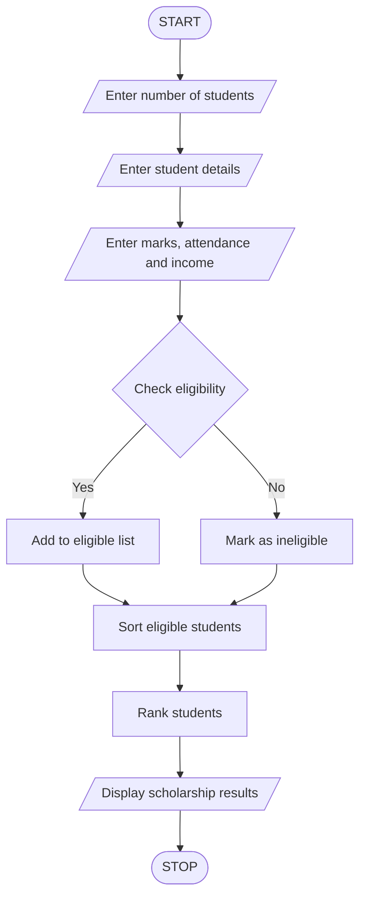

## 1. Problem Statement

Develop a Python program to allocate scholarships to students based on their academic performance and eligibility criteria. The system should collect student details, including name, aggregate marks, subject-wise marks, attendance percentage, and family annual income.

The program should:

- Check whether the student has minimum aggregate marks of 75%.
- Check whether each subject mark is at least 60.
- Check whether attendance is at least 75%.
- Check whether annual family income is below ₹2,00,000.
- Display eligible and ineligible students.
- Rank eligible students based on aggregate marks.
- Resolve ties using attendance percentage and family income.

## 2. Algorithm

1. Start the program.
2. Read the number of students.
3. Enter each student's name.
4. Read aggregate marks.
5. Read subject-wise marks.
6. Read attendance percentage.
7. Read annual family income.
8. Check all eligibility conditions.
9. If all conditions are satisfied, add the student to the eligible list.
10. Otherwise, display the student as ineligible.
11. Sort eligible students based on:
    - Highest aggregate marks.
    - Highest attendance.
    - Lowest family income.
12. Display the scholarship ranking.
13. Stop the program.

## 3. Flowchart


## 4. Sample Input

```
Enter number of students: 3

Enter details of Student 1
Enter student name: Ravi
Enter aggregate marks: 85
Enter subject mark: 80
Enter subject mark: 90
Enter subject mark: 85
Enter attendance percentage: 90
Enter annual family income: 150000

Enter details of Student 2
Enter student name: Priya
Enter aggregate marks: 92
Enter subject mark: 95
Enter subject mark: 90
Enter subject mark: 92
Enter attendance percentage: 95
Enter annual family income: 120000

Enter details of Student 3
Enter student name: Kumar
Enter aggregate marks: 65
Enter subject mark: 70
Enter subject mark: 65
Enter subject mark: 60
Enter attendance percentage: 80
Enter annual family income: 100000
```

## 5. Sample Output

```
Kumar is not eligible for scholarship

----- SCHOLARSHIP RESULTS -----

Eligible Students Ranking:

Rank: 1
Name: Priya
Aggregate Marks: 92.0
Attendance: 95.0
Family Income: 120000.0
Status: Scholarship Eligible

Rank: 2
Name: Ravi
Aggregate Marks: 85.0
Attendance: 90.0
Family Income: 150000.0
Status: Scholarship Eligible

Total Eligible Students: 2


Thus, the University Scholarship Allocation System is successfully implemented using Python. It checks student eligibility, identifies qualified students, ranks them according to academic performance, and resolves ties using attendance and family income.
